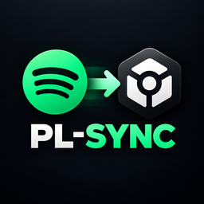
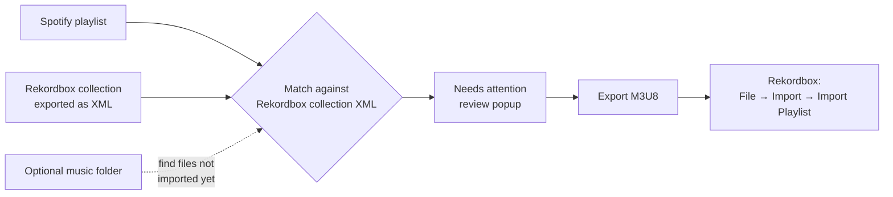

<div align="center">



# PL-SYNC

### Rebuild your Spotify playlists from the music you already own in Rekordbox


</div>

---

**PL-SYNC** (Python package `spot2rb`) matches the tracks in your Spotify playlists against the files in your Rekordbox collection and exports the result as an **M3U8 playlist** you can import into Rekordbox. Spotify provides the list and order; your local files provide the audio and tags. Nothing in your collection is ever modified.

## ✨ Features

- 🔗 **Spotify login with PKCE** – you only need a Client ID. No client secret is required.
- 🎯 **Smart matching** – tracks are matched to your Rekordbox collection by identity and duration first, then by file quality (lossless and higher bitrate win).
- 🟩 **Confidence boxes** – five boxes show how sure the match is (1–2 low, 3 possible, 4 strong, 5 very strong).
- 🧐 **Review before export** – anything uncertain opens a **Needs attention** popup where you accept a candidate, pick another file, or skip.
- 🎧 **Built-in preview** – listen to a candidate with play/pause and a seek slider before accepting it.
- 📂 **Optional folder scan** – detect songs that are on disk but not yet imported into Rekordbox.
- 🗂️ **Queue** – batch several playlists, then run them in one go.
- 🔄 **Change tracking** – a marker shows whether a playlist is *Queued*, *Exported* or *Changed* since your last export.
- 🔐 **Encrypted login** – tokens are stored with Windows DPAPI, so only your Windows account can read them.
- 🎛️ **CDJ-inspired dark UI** – custom-drawn Tkinter controls, no extra UI dependencies.

## 🔄 How it works



## 🚀 Quick start

**Requirements:** Windows, Python 3.11+ with Tkinter. [FFmpeg](https://ffmpeg.org/download.html) on your `PATH` is optional and only improves audio preview.

```powershell
git clone https://github.com/GitHubuser5o5/pl-sync.git
cd pl-sync
python -m pip install -r requirements.txt
python -m spot2rb.app
```

Or double-click **`start.bat`**. It launches the app without a console window (crashes are written to `spot2rb/data/app.log`) and uses a `.venv` in the project folder if one exists.

## 🎛️ Using the app

### 1. Connect (one time)

1. Create an app in the [Spotify Developer Dashboard](https://developer.spotify.com/dashboard) and add `http://127.0.0.1:8888/callback` as a redirect URI.
2. Paste the app's **Client ID** into the **Connect** tab and log in.
3. In Rekordbox, export your collection as XML, then choose that file in Connect. Re-export it whenever your collection changes.
4. *(Optional)* Choose a **music folder** to detect songs that aren't in Rekordbox yet. Tick **Also search subfolders** and use **Choose subfolders…** to limit which ones are included, then press **Scan local library**. Folder-only files are never eligible for export.
5. Choose a **Download folder**. Exported M3U8 files are saved there.

Everything is remembered. On launch the app rescans your saved folder and XML and refreshes your Spotify playlists.

### 2. Playlists

- Type in the **Search** box to filter playlists by name (Esc or **Clear** shows them all again).
- Select a playlist and choose **Export** or **Add to queue**. Its latest tracks are fetched automatically. Use **Preview playlist** if you want to inspect the track list first.
- Enter a name for the playlist when asked. The result is always an `.m3u8` file.
- If decisions are needed, **Needs attention** opens: accept a candidate, choose another registered file, or skip each remaining track. Your previous manual choices are remembered. **Auto** takes the best-ranked file for every open track and skips tracks with no candidate.
- The **Marker** column shows *Queued*, *Exported* or *Changed* (amber = edited in Spotify after your last export).

### 3. Queue

The **Queue** tab holds the tasks you submitted. Press **Start queue** to write all of them to your Download folder, or select tasks and press Delete / Backspace to remove them, or **Clear** to empty the list. Tasks use their already-reviewed matches, so nothing is re-fetched or re-matched while the queue runs. Failed tasks are shown in the list and the rest continue. Existing output files are backed up before being replaced, and duplicate names get a numbered suffix.

### 4. Import into Rekordbox

In Rekordbox choose **File → Import → Import Playlist** and select the exported `.m3u8`.

> ⚠️ Live updates inside a running Rekordbox are **not** implemented. PL-SYNC writes files; it never creates or changes playlists inside Rekordbox directly. Adding songs to an existing playlist remains a manual step.

## ℹ️ Good to know

- **Spotify development mode** requires the app owner to have Premium and only exposes the contents of playlists you own or collaborate on. Other playlists (saved, followed, Spotify's own) are hidden because their tracks can't be fetched. See Spotify's [migration guide](https://developer.spotify.com/documentation/web-api/tutorials/february-2026-migration-guide).
- A file is used **once per playlist**. If several Spotify entries match the same file (the same song on two albums, say), the closest fit keeps it and the others are marked as duplicates.
- Local data (settings, login, playlists, scan results, queue) lives in `spot2rb/data/`. It is git-ignored, so your login never ends up in a commit.
- Your Rekordbox XML, audio files and cue / beatgrid data are never modified.

## 🧪 Tests

```powershell
python -m unittest discover -s tests -v
python tests/gui_smoke.py
```

The desktop check uses temporary data and silent audio. It covers the three tabs, the name popup, review before queueing, M3U8 export, queue delete / clear, saved tasks, startup refresh and the preview controls. A live Spotify login and a real Rekordbox import need your own account and app.

## 🗂️ Project layout

```
pl-sync/
├── start.bat               # windowless launcher
├── requirements.txt
├── spot2rb/
│   ├── app.py              # entry point
│   ├── config.toml         # Spotify defaults (empty Client ID)
│   ├── core/               # Spotify client, matcher, library scan, M3U8, queue, state
│   ├── ui/                 # custom-drawn Tkinter UI and dialogs
│   ├── assets/             # logo and icons
│   └── data/               # local app data (git-ignored)
└── tests/                  # unit tests + GUI smoke test
```

## ⚖️ Disclaimer

PL-SYNC is a personal tool. It is not affiliated with or endorsed by Spotify or AlphaTheta / Pioneer DJ. Spotify and Rekordbox are trademarks of their respective owners.
